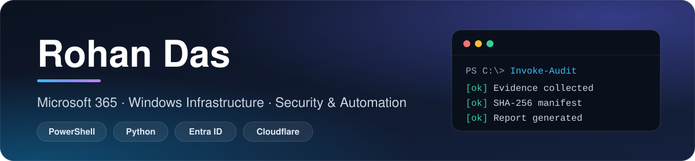
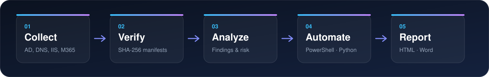

 

*"Automate what can be automated, secure what must be protected, and build tools that make infrastructure easier to operate."*

 

---

## About

I build, secure, and automate **enterprise Windows and Microsoft 365 environments**. My work spans server infrastructure, cloud migrations, load balancing, CDN/edge security, and turning repetitive operational and auditing tasks into reusable **PowerShell** and **Python** frameworks.

| ☁️ Microsoft 365 | 🖥️ Windows Infrastructure | 🛡️ Security | ⚙️ Automation |
| :---: | :---: | :---: | :---: |
| Identity, Mail, Endpoint | AD, Hyper-V, IIS | IR, Hunting, Compliance | PowerShell, Python |

**🍋 Currently:** working on projects and publishing notes, tools, and scripts for sysadmins.

---

## How I Work

---

## Tech Stack

 

| Domain | Technologies & Focus |
| :--- | :--- |
| ☁️ **Microsoft 365 & Cloud** | `Entra ID` `Exchange Online` `Intune` `Purview` `Defender` `Graph API` `Conditional Access` `Entra Connect` `Exchange Hybrid` `SPF/DKIM/DMARC` |
| 🖥️ **Windows & Virtualization** | `Windows Server 2016–2025` `Active Directory` `GPO` `DNS/DHCP/DoH` `AD CS/FS` `IIS` `Hyper-V` `Proxmox VE` `VMware` `SAN/LUN Storage` |
| 🌐 **Edge, CDN & Load Balancing** | `Cloudflare (CDN, DNS, WAF, DDoS)` `F5 BIG-IP (LTM, WAF/AWAF)` `Reverse Proxy` `Load Balancers` `IIS ARR / URL Rewrite` `SSL/TLS` |
| 🔄 **Migrations & Disaster Recovery** | `Tenant-to-Tenant` `Exchange` `SharePoint` `OneDrive` `DNS` `SQL Server & VM` `Robocopy` `Acronis Cyber Protect` `Backup Verification` |
| 🛡️ **Security & Auditing** | `Incident Response` `Threat Hunting` `Sophos XDR` `CrowdStrike` `Wazuh` `Cisco/FortiGate` `SHA-256 Evidence Manifests` `Compliance Reporting` |
| 🗄️ **Databases & Automation** | `SQL Server 2016–2022` `PostgreSQL` `MySQL/MariaDB` `SQLite` `PowerShell` `Python` `Bash` `Batch` `Node.js` `React` `.NET` `PHP/Laravel` `Mermaid.js` |

---

## Projects & Repositories

### Infrastructure, Audit & Monitoring

| Repository | What it does | Stack |
| :--- | :--- | :--- |
| [**DLSAR_Audit_Framework**](https://github.com/3ls3if/DLSAR_Audit_Framework) | Reusable infrastructure auditing framework: evidence collection (AD, DNS, Firewall, IIS, Hyper-V), SHA-256 manifests, automated Word audit reports | `PowerShell` `Python` |
| [**Windows-DNS-Migration-Toolkit**](https://github.com/3ls3if/Windows-DNS-Migration-Toolkit) | DNS zone export, record collection, configuration analysis, migration assistance, and evidence collection | `PowerShell` |
| [**Centralized-Monitoring-System**](https://github.com/3ls3if/Centralized-Monitoring-System) | Cross-platform telemetry and server health dashboard with Windows and Linux agents | `React` `Node.js` `PowerShell` `SQLite` `Bash` |
| [**Windows-Server-Health-Monitor**](https://github.com/3ls3if/Windows-Server-Health-Monitor) | Continuous monitoring with an interactive Chart.js dashboard: CPU, memory, disk, sessions, IIS, SQL Server, services | `PowerShell` `Chart.js` |
| [**Windows-Server-Audit-Script**](https://github.com/3ls3if/Windows-Server-Audit-Script) | Security audit producing HTML reports with findings, risk assessments, and remediation steps | `PowerShell` `HTML` |
| [**M365-Audit-Report-Generator**](https://github.com/3ls3if/M365-Audit-Report-Generator) | Auditing and reporting tool for Microsoft 365 environments | `PowerShell` |
| [**sys-admin-book**](https://github.com/3ls3if/sys-admin-book) | Public template repo of System Admin notes that powers the [rohan.us.ci](https://rohan.us.ci) workbench | `Markdown` |

### Security & Research Tools

| Repository | What it does | Stack |
| :--- | :--- | :--- |
| [**Forensics-Credential-Harvester**](https://github.com/3ls3if/Forensics-Credential-Harvester) | Cross-platform digital forensics tool for recovering browser credentials (Chrome, Firefox, Safari, Brave, etc.) | `Python` |
| [**Recon-Auditor**](https://github.com/3ls3if/Recon-Auditor) | A recon and auditing tool | `Python` |
| [**Cybersecurity-Tools**](https://github.com/3ls3if/Cybersecurity-Tools) | Collection of cybersecurity tools | `Python` |
| [**Source-Code-Analyzer**](https://github.com/3ls3if/Source-Code-Analyzer) | Identifies and analyzes vulnerabilities in source code across multiple programming languages using machine learning | `Jupyter Notebook` |
| [**Code-Keyword-Extraction-Tool--CKET**](https://github.com/3ls3if/Code-Keyword-Extraction-Tool--CKET) | Extracts and classifies keywords from source code using machine learning and AST-based techniques | `Python` |
| [**Secure-Text-Transfer**](https://github.com/3ls3if/Secure-Text-Transfer) | Cloud-based web app that transfers text securely using asymmetric cryptography | `JavaScript` |
| [**Scrape-2-Rule-Em**](https://github.com/3ls3if/Scrape-2-Rule-Em) | A web scraper that extracts data from a website | `Python` |

---

## The Workbench: [rohan.us.ci](https://rohan.us.ci)

A free, 100% client-side toolkit and documentation hub for Windows Server, networking, and scripting, synced live with the [`sys-admin-book`](https://github.com/3ls3if/sys-admin-book) repo.

| Tool | Purpose |
| :--- | :--- |
| 🌐 **DNS Explorer (DoH)** | Query A, AAAA, CNAME, MX, TXT, NS, SRV, SOA, and PTR records through Cloudflare or Google resolvers |
| 💾 **Storage & RAM Converter** | Binary (1024) vs decimal (1000) capacity math for SAN LUNs, VHDX, RAM, and disks, plus pagefile sizing and IOPS-to-throughput |
| 🖧 **Subnet & DHCP Scope Builder** | IPv4 CIDR calculator and ready-to-run `Add-DhcpServerv4Scope` PowerShell generator |
| ⚡ **PowerShell Arsenal** | Parameter builders for audit, IIS log parsing, SQL backup, server health, M365 guest cleanup, and Robocopy jobs |
| 🗺️ **Network Architecture Builder** | Drag-and-drop topology canvas that exports to PNG or Mermaid code |
| 📝 **Admin Scratchpad** | Draft scripts in the browser and export as `.txt`, `.ps1`, `.bat`, or `.reg` |

Available in English, Assamese, Chinese, and Japanese, with multiple themes and a knowledge-graph view of the docs.

---

## Certifications

---

## Let's Connect

Have an infrastructure, migration, or automation challenge?

**[LinkedIn](https://linkedin.com/in/iamrohandas)** · **[Blog](https://rohan.us.ci)** · **[Portfolio](https://3ls3if.github.io/portfolio/)** · **[Notes](https://r0han.gitbook.io)**

